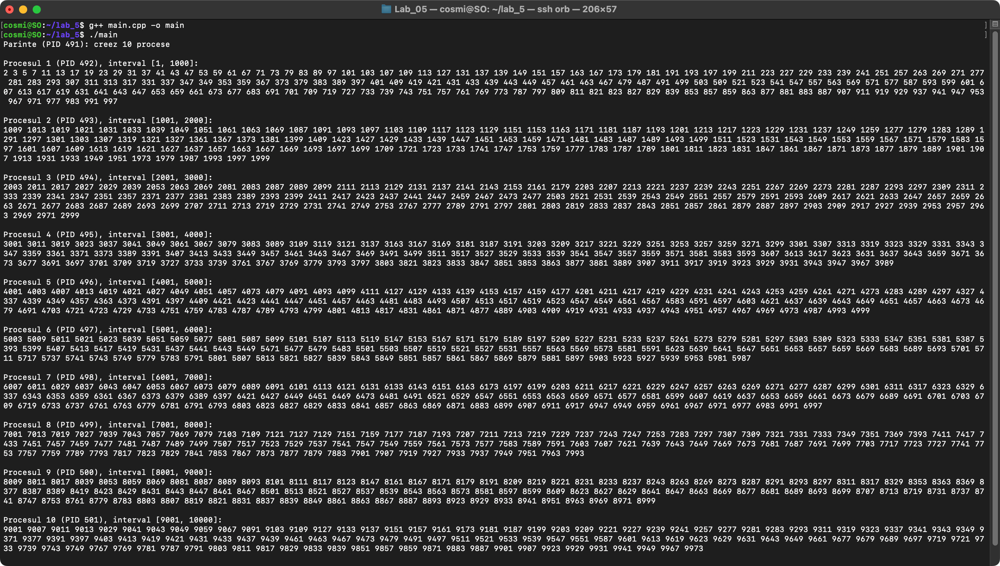
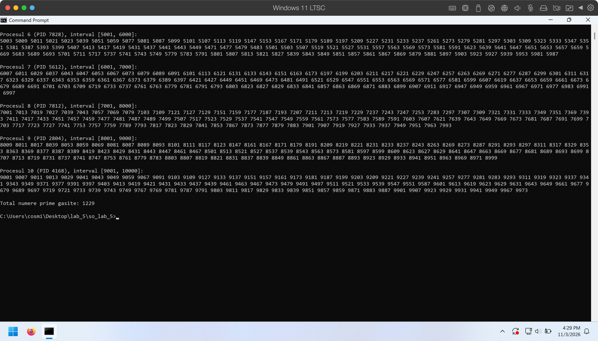

# Laborator 5 - Numere prime cu procese si pipe-uri

Link git: https://github.com/cosminpatrascuro/so_lab_5

## Cerinta

Un program C++ care cauta numerele prime pana la 10000, cu 10 procese. Fiecare proces primeste prin pipe un interval de 1000 de numere si trimite numerele prime inapoi la procesul initial, care le afiseaza. Programul trebuie facut si pentru Windows, si pentru Linux.

## Cum functioneaza

1. Procesul initial creeaza 10 procese si cate 2 pipe-uri pentru fiecare: unul pentru interval si unul pentru rezultate.
2. Fiecare proces primeste intervalul lui: 1-1000, 1001-2000, ..., 9001-10000.
3. Fiecare proces cauta numerele prime din interval si le trimite inapoi prin pipe.
4. Procesul initial citeste numerele si le afiseaza.

## Diferente intre Linux si Windows

| | Linux | Windows |
|---|---|---|
| Creare proces | `fork` | `CreateProcess` |
| Creare pipe | `pipe` | `CreatePipe` |
| Citire si scriere | `read`, `write` | `ReadFile`, `WriteFile` |

In Linux, procesul copil continua din acelasi cod si are deja acces la pipe-uri. In Windows, copilul porneste programul de la inceput, asa ca l-am pornit cu argumentul `copil`, iar pipe-urile le primeste ca stdin si stdout.

## Ce am observat

- Capetele de pipe nefolosite trebuie inchise. Altfel, procesul initial poate ramane blocat la citire.
- Varianta de Linux a fost mai simpla, pentru ca `fork` si `pipe` cer mai putin cod.

## Rulare

Am rulat programele in doua masini virtuale, una cu Linux si una cu Windows 11. Ambele au functionat.

### Linux

### Windows

